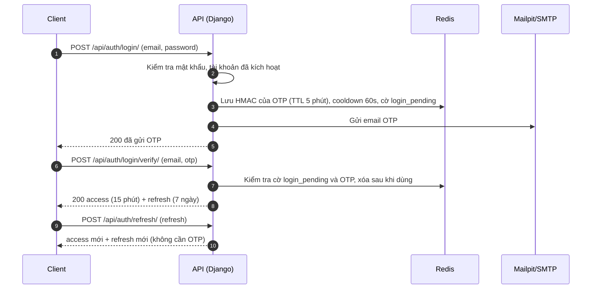

# Enterprise Project & Workflow Management System

Hệ thống quản lý dự án, công việc và quy trình phê duyệt nội bộ doanh nghiệp (kiểu Jira + Trello đơn giản hóa).

**Tech stack:** Django, Django REST Framework, PostgreSQL 16, Redis 7, React (Vite), Ant Design, Docker Compose.

## Yêu cầu

- Windows 11, PowerShell
- Docker Desktop
- Python 3.12
- Node.js LTS (20.19+ hoặc 22.12+)

## Chạy nhanh (Windows)

```powershell
.\scripts\setup_dev.ps1   # chạy 1 lần: venv, thư viện, .env, Docker, migrate
.\scripts\run_dev.ps1     # mỗi lần dev: bật Docker, Django, Vite
```

Mở http://localhost:5173 để xem trạng thái hệ thống.

## Địa chỉ khi dev

| Dịch vụ | Địa chỉ |
|---|---|
| Frontend (Vite) | http://localhost:5173 |
| API | http://localhost:8000/api/ |
| Swagger UI | http://localhost:8000/api/docs/ |
| ReDoc | http://localhost:8000/api/redoc/ |
| Mailpit (xem email dev) | http://localhost:8025 |
| PostgreSQL | `localhost:5433` |
| Redis | `localhost:6379` |

## Cấu trúc

- `backend/`: Django REST API
  - `accounts/`: người dùng, xác thực, JWT
  - `common/`: OTP (`otp.py`), gửi email (`email.py`), phân quyền (`permissions.py`)
  - `templates/emails/`: mẫu email tiếng Việt (text + HTML)
- `frontend/`: React (Vite)
- `scripts/`: script setup và chạy dev
- `docker-compose.yml`: PostgreSQL + Redis + Mailpit

## Xác thực (Phase 1)

### Luồng

- **Đăng ký:** `register` (tạo tài khoản chưa kích hoạt, gửi OTP) rồi `verify-email` (nhập OTP, kích hoạt).
- **Đăng nhập hai bước:** `login` (email + mật khẩu, gửi OTP) rồi `login/verify` (nhập OTP, nhận access + refresh token).
- **Access token** sống 15 phút, hết hạn thì gọi `refresh` (không cần OTP). **Refresh token** sống 7 ngày, hết hạn thì đăng nhập lại từ bước 1.

### Endpoint

| Method | Đường dẫn | Mô tả |
|---|---|---|
| POST | `/api/auth/register/` | Tạo user chưa kích hoạt, gửi OTP |
| POST | `/api/auth/verify-email/` | Email + OTP, kích hoạt tài khoản |
| POST | `/api/auth/resend-otp/` | Gửi lại OTP (`purpose`: `REGISTER` hoặc `LOGIN`) |
| POST | `/api/auth/login/` | Bước 1: kiểm tra mật khẩu, gửi OTP |
| POST | `/api/auth/login/verify/` | Bước 2: email + OTP, trả access + refresh |
| POST | `/api/auth/refresh/` | Đổi refresh token lấy cặp token mới |
| POST | `/api/auth/logout/` | Thu hồi (blacklist) refresh token |
| GET | `/api/auth/me/` | Thông tin người dùng hiện tại |
| GET | `/api/auth/users/` | Danh sách người dùng (chỉ ADMIN) |

### Sơ đồ đăng nhập hai bước



### Bảo mật

- OTP sinh bằng `secrets`, lưu **bản băm HMAC** trong Redis (không lưu mã gốc), hết hạn sau 5 phút, dùng một lần.
- Mỗi mã cho sai tối đa 5 lần; gửi lại cách nhau tối thiểu 60 giây.
- Đăng nhập sai email hoặc sai mật khẩu trả cùng một thông báo.
- Rate limit 5 lần/phút/IP cho 5 API công khai (`register`, `verify-email`, `resend-otp`, `login`, `login/verify`), trả 429 kèm `Retry-After`.
- Phân quyền RBAC (`ADMIN`, `MANAGER`, `EMPLOYEE`) kiểm tra ở backend bằng DRF permission class.
- Lưu ý: `register` trả 400 khi email đã đăng ký (ưu tiên dễ dùng), nên được bảo vệ bằng rate limit.

## Chạy test

Cần Docker đang chạy (Django tạo database tạm `test_epwms_db` trong container Postgres). Không cần `runserver`.

```powershell
cd backend
.\.venv\Scripts\Activate.ps1
python manage.py test --noinput
```

## Ghi chú

- Postgres trong Docker dùng cổng **5433** để tránh đụng Postgres cài sẵn trên máy. `DB_PORT` trong `.env` phải là 5433.
- Mọi email dev được giữ lại trong Mailpit, không gửi ra Internet.
- Health check: `GET /api/health/`
- Không commit file `.env`. Hãy đổi `SECRET_KEY` khi triển khai thật.